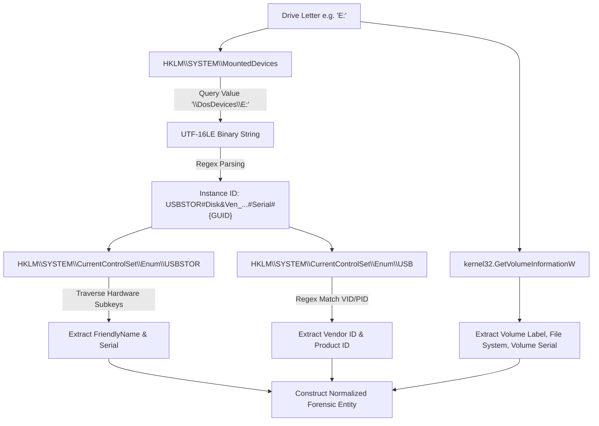

# Chapter: Host-Based Telemetry Collection — USB Storage & File-System Monitoring

> **Author:** Chetna Bothra (Lead for USB & File-System Telemetry)  
> **Component:** Endpoint Telemetry Subsystem (`agent/collectors/usb_collector.py`, `agent/collectors/fs_collector.py`)  
> **Peer Reviewer:** Daksh Shaparia (Agent Core & Event Log Collector Lead)  
> **Milestone:** Phase 2 Technical Draft per ForensiTrace Build & Execution Plan (Page 6, Step 4)  
> **Status:** READY FOR PEER REVIEW  

---

## 1. Introduction & Forensic Motivation

Digital forensic incident response on modern endpoint operating systems frequently suffers from the *semantic gap*: individual operating system operations generate fragmented, unlinked telemetry records scattered across disparate log channels, or fail to produce standard security log events altogether. In typical insider threat, data exfiltration, or staging scenarios (e.g., ForensiTrace Scenario A: **USB Drive Insertion $\rightarrow$ File Staging $\rightarrow$ Process Execution**), the physical attachment of removable media and subsequent filesystem operations represent critical early stages of the attack chain.

Standard Windows logging possesses severe limitations for physical device tracking and filesystem integrity:
1. **Disabled-by-Default USB Telemetry:** Advanced device auditing channels such as `Microsoft-Windows-DriverFrameworks-UserMode/Operational` (Event ID 2003/2102) are disabled by default in vanilla Windows 10 and 11 installations to conserve storage. Relying solely on default Windows Event Logs leaves endpoint analysts blind to physical USB bus connections.
2. **Disconnected Forensic Identifiers:** When a storage drive is inserted, Windows assigns a logical drive letter (e.g., `E:`). Standard process creation logs (Event ID 4688) capture executable paths referencing this drive letter, but provide zero intrinsic linkage back to the physical device hardware descriptors, serial numbers, vendor identifiers, or volume labels.
3. **Telemetry Flooding on Mass Storage:** Naive filesystem monitoring of storage volumes generates overwhelming disk I/O noise. Background operating system routines, search indexers, browser caches, and office temporary locks generate thousands of micro-mutations per minute.
4. **The File-Copy Write-Storm Problem:** Operating system file copies execute via chunked block I/O. When an investigator or adversary copies an executable to a disk volume, the operating system emits an initial creation event followed by dozens of rapid modification notifications as successive 64 KB blocks are flushed to persistent media. If unmanaged, downstream correlation engines face severe event amplification and false-positive activity generation.

To resolve these challenges, the ForensiTrace endpoint agent incorporates two dedicated telemetry collectors designed and implemented by Chetna:
- The **USB Device Telemetry Collector (`USBCollector`)**: Detects physical drive arrival and removal in real time, interrogates Windows kernel data structures and registry hives to reconstruct full hardware provenance (serial numbers, friendly names, VID/PID), and notifies dependent components.
- The **File-System Telemetry Collector (`FileSystemCollector`)**: Utilizes low-overhead kernel directory watching (`ReadDirectoryChangesW` via Python `watchdog`), attaches dynamically to newly mounted removable media upon hardware detection, and executes temporal debouncing and multi-tier noise filtering.

---

## 2. Technical Background & Windows Telemetry Architecture

### 2.1 USB Subsystem Architecture & Notification Loop

When a user attaches a USB mass storage device to a Windows host, the Windows Plug and Play (PnP) subsystem, USB bus drivers (`usbhub.sys`), and USB mass storage driver (`usbstor.sys`) negotiate device enumeration. Once partition tables are parsed, the Windows Mount Manager (`mountmgr.sys`) allocates an available logical drive letter (`\DosDevices\X:`).

To intercept this sequence without requiring intrusive kernel-mode drivers, `USBCollector` employs a **dual-layer detection model**:

```
                             [ Physical USB Device Inserted ]
                                             │
                        ┌────────────────────┴────────────────────┐
                        ▼                                         ▼
            [ Windows PnP Subsystem ]                [ Windows Mount Manager ]
                        │                                         │
              WM_DEVICECHANGE (0x0219)                \DosDevices\E: Created
                        │                                         │
                        ▼                                         ▼
         ┌───────────────────────────────┐        ┌───────────────────────────────┐
         │  Layer 1: Real-Time Win32     │        │  Layer 2: Fallback Polling    │
         │  Hidden Message Window        │        │  Logical Drive Reconciler     │
         │  (DBT_DEVICEARRIVAL 0x8000)   │        │  (GetLogicalDrives & Types)   │
         └──────────────┬────────────────┘        └──────────────┬────────────────┘
                        │                                        │
                        └────────────────────┬───────────────────┘
                                             ▼
                             [ Dynamic Identity Resolver ]
                                             │
                      ┌──────────────────────┼──────────────────────┐
                      ▼                      ▼                      ▼
             HKLM\SYSTEM\MountedDevices  HKLM\...\Enum\USBSTOR    GetVolumeInformationW
             (Binary Instance ID)       (Friendly Name & Serial)  (Serial & File System)
                                             │
                                             ▼
                           [ Emit Normalized DEVICE_ARRIVED ]
                                             │
                                             ▼
                       [ Direct Hook: handle_drive_event("E:") ]
```

#### Layer 1: Win32 Message Broadcast Interception
The primary notification path registers an unmapped, hidden Win32 window class with a specialized window procedure (`_wnd_proc`). The collector intercepts system-wide `WM_DEVICECHANGE` (`0x0219`) broadcasts:
- **`DBT_DEVICEARRIVAL` (`0x8000`):** Broadcast when a new device or volume becomes available.
- **`DBT_DEVICEREMOVECOMPLETE` (`0x8004`):** Broadcast when a device or volume is safely or abruptly unmounted.

When `lparam` points to a `DEV_BROADCAST_HDR` structure with `dbch_devicetype == DBT_DEVTYP_VOLUME` (`0x00000002`), the structure is cast to `DEV_BROADCAST_VOLUME`. The `dbcv_unitmask` field contains a 32-bit bitmask where bit $i$ ($0 \le i \le 25$) corresponds to drive letter $\text{chr}(65 + i)$. For example:
$$\text{dbcv\_unitmask} = 16 = 2^4 \implies \text{Bit 4} \implies \text{Drive 'E:'}$$

#### Layer 2: State-Reconciliation Safety Fallback
In headless environments, remote desktop sessions, or containerized testbeds where graphical message dispatching (`PumpWaitingMessages`) may be delayed, a secondary periodic reconciler evaluates logical drive states using `ctypes.windll.kernel32.GetLogicalDrives()` and `GetDriveTypeW()`. Removable volumes (`DRIVE_REMOVABLE = 2`) are reconciled against the internal `_known_devices` state table every $1.0\text{ s}$, ensuring no device arrival or removal is ever dropped.

### 2.2 Forensic Artifact Interrogation & Identity Corroboration

Once a drive letter is captured, `USBCollector` executes a multi-stage registry traversal to corroborate hardware evidence before emitting the event:



1. **`HKLM\SYSTEM\MountedDevices`:**
   Maps the logical DOS drive name (`\DosDevices\E:`) to its hardware instance identifier. The raw binary payload contains a UTF-16LE string format:
   ```
   \??\USBSTOR#Disk&Ven_SanDisk&Prod_Ultra&Rev_1.00#4C53000123456789#{53f56307-b6bf-11d0-94f2-00a0c91efb8b}
   ```
   Regular expression tokenizers parse vendor (`Ven_SanDisk`), product model (`Prod_Ultra`), firmware revision (`Rev_1.00`), and hardware serial number (`4C53000123456789`).
2. **`HKLM\SYSTEM\CurrentControlSet\Enum\USBSTOR`:**
   Locates the active device registration subkey, resolving the user-friendly hardware descriptor (`FriendlyName`, e.g., `"SanDisk Ultra"`).
3. **`HKLM\SYSTEM\CurrentControlSet\Enum\USB`:**
   Traverses the parent USB hub enumeration tree to extract 4-digit hexadecimal Vendor IDs (`VID_0781`) and Product IDs (`PID_5581`).
4. **`GetVolumeInformationW`:**
   Directly queries volume metadata to capture the human-assigned volume label (e.g., `"SECURE_USB"`), file system formatting (`FAT32`, `exFAT`, `NTFS`), and 32-bit volume serial number.

---

## 3. Architecture & Inter-Collector Contracts

### 3.1 BaseCollector Lifecycle & Threading Model

Both `USBCollector` and `FileSystemCollector` inherit from `BaseCollector` (`agent/collectors/base.py`), strictly adhering to the thread-safe lifecycle contract mandated by `docs/agent_interface.md`:

```python
class BaseCollector(ABC):
    def __init__(self, event_queue: queue.Queue[Dict[str, Any]], config: Optional[Any] = None, name: str = "BaseCollector") -> None:
        self.event_queue = event_queue
        self.config = config
        self.name = name
        self._running = False
        self._listeners: List[Callable[[str, str], None]] = []

    @abstractmethod
    def start(self) -> None:
        """Initializes collector resources and spawns background worker threads. Non-blocking."""
        pass

    @abstractmethod
    def stop(self) -> None:
        """Gracefully terminates worker loops, releases OS handles. Idempotent."""
        pass

    def emit(self, event_dict: Dict[str, Any]) -> None:
        """Pushes validated event dictionary to the thread-safe agent queue without blocking."""
        self.event_queue.put_nowait(event_dict)
```

### 3.2 The Zero-Latency Inter-Collector Hook (`handle_drive_event`)

A core innovation in the ForensiTrace agent design is the inter-collector hand-off mechanism. Monitoring fixed disks like `C:\` continuously exhausts CPU and memory. However, when an adversary inserts a removable drive, file mutations can occur within tens of milliseconds.

Two coordination designs were evaluated:
- **Design Option A (Direct Synchronous Callback Hook):** The USB collector maintains a registry of listeners. The instant `DEVICE_ARRIVED` is validated, it invokes registered listeners directly.
- **Design Option B (Inter-Collector Queue Polling):** The USB collector posts to an internal queue; the File-System collector runs an auxiliary polling thread to consume drive letters.

| Architectural Dimension | Option A: Direct Synchronous Hook *(Selected)* | Option B: Queue Polling |
|---|:---:|:---:|
| **Handoff Latency** | **$< 0.1\text{ ms}$ (Immediate)** | $100\text{--}500\text{ ms}$ (Polling cycle dependent) |
| **Race Condition Vulnerability** | **None: Directory watcher active before file write finishes** | High: File copy can complete prior to polling cycle |
| **System Overhead** | Zero additional background threads | Dedicated polling thread running continuously |
| **Thread Safety** | Guaranteed: `watchdog.Observer.schedule()` is thread-safe | Requires external mutex synchronizations |

**Selected Implementation:**
In `agent/main.py`:
```python
fs_collector = FileSystemCollector(event_queue, config)
usb_collector = USBCollector(event_queue, config)

# Wire the zero-latency hand-off callback:
usb_collector.register_drive_listener(fs_collector.handle_drive_event)
```

In `agent/collectors/fs_collector.py`:
```python
def handle_drive_event(self, drive_letter: str, event_type: str) -> None:
    letter = drive_letter.upper()
    if not letter.endswith(":"):
        letter = f"{letter}:"

    logger.info("[%s] [HOOK] Received drive event: drive='%s', action='%s'", self.name, letter, event_type)

    if event_type == "ATTACHED":
        self.watch_directory(f"{letter}\\")
    elif event_type == "REMOVED":
        self.unwatch_directory(f"{letter}\\")
```

---

## 4. File-System Collector & Debouncing Engine

### 4.1 Low-Overhead Kernel Notification via `watchdog`

`FileSystemCollector` utilizes Python's `watchdog` library, which interfaces with the Windows `ReadDirectoryChangesW` Win32 API. `ReadDirectoryChangesW` operates asynchronously via Windows I/O Completion Ports (IOCP) or alertable wait threads, delivering native notifications of directory mutations directly from the kernel NTFS/FAT driver without polling disk contents.

### 4.2 Multi-Tier Static Noise Filtering

To isolate forensic signal from operating system noise, incoming filesystem events pass through `is_ignored_path()` before normalization:
1. **Directory Filtering:** Directory nodes themselves (`is_directory=True`) are ignored; only file-level payload actions are recorded.
2. **System Volume Metadata:**
   - `$RECYCLE.BIN`
   - `System Volume Information`
3. **Office & Application Lock Prefixes:**
   - `~$*` (Microsoft Office owner lock files)
   - `.~*` and `.~lock.*` (LibreOffice temporary locks)
   - `._*` (AppleDouble metadata written by macOS hosts)
4. **Temporary & Incomplete File Extensions:**
   - `.tmp`, `.temp` (General application temporary files)
   - `.crdownload`, `.part`, `.partial` (Incomplete browser and network downloads)
   - `.swp`, `.swo` (Vim / text editor swap files)
   - `.laccdb`, `.ldb` (Microsoft Access lock files)
5. **System Artifact Files:**
   - `desktop.ini`, `thumbs.db`, `autorun.inf`, `.DS_Store`

### 4.3 The Temporal Burst Debouncing Algorithm

Windows file copy operations emit multiple distinct file notifications for a single user action:
$$\text{User Action: Copy } P \implies [\text{created}, \text{modified}_1, \text{modified}_2, \dots, \text{modified}_n]$$

If each modification is emitted, rule R1 ("Device arrives $\rightarrow$ File created/modified") would trigger duplicate activity records, and downstream database ingestion would suffer unnecessary write contention.

`FileSystemCollector` implements a stateful dual-window debouncing algorithm:

```
Timeline for Copying "payload.exe" (5 MB file):

  t = 0.0s          t = 0.05s         t = 0.20s         t = 0.80s              t = 2.5s
     │                 │                 │                 │                      │
     ▼                 ▼                 ▼                 ▼                      ▼
[ OS on_created ]  [ OS on_modified ] [ OS on_modified ] [ OS on_modified ]   [ Subsequent Mutation ]
     │                 │                 │                 │                      │
     ▼                 ▼                 ▼                 ▼                      ▼
  Is Ignored?       Is Ignored?       Is Ignored?       Is Ignored?            Is Ignored?
    (No)              (No)              (No)              (No)                   (No)
     │                 │                 │                 │                      │
     ▼                 ▼                 ▼                 ▼                      ▼
Record creation:    Within 1.5s       Within 1.5s       Within 1.5s            Delta = 2.5s > 1.5s
_recent_creations   of creation?      of creation?      of creation?           Delta = 1.7s > 1.0s
     │                (YES)             (YES)             (YES)                   │
     ▼                 │                 │                 │                      ▼
[ EMIT EVENT ]         ▼                 ▼                 ▼               [ EMIT EVENT ]
 FILE_CREATED     [ SUPPRESS ]      [ SUPPRESS ]      [ SUPPRESS ]          FILE_MODIFIED
```

#### Mathematical Formulation
Let $P$ represent the canonical file path, $A \in \{\text{CREATED}, \text{MODIFIED}, \text{MOVED}, \text{DELETED}\}$ represent the file action, and $t_{\text{now}}$ represent the current monotonic clock timestamp (`time.monotonic()`).

1. **Post-Creation Modification Suppression:**
   $$\text{Suppress}(A, P) \iff A = \text{FILE\_MODIFIED} \land (t_{\text{now}} - \text{last\_created}(P) < T_{\text{mod\_window}})$$
   Where default $T_{\text{mod\_window}} = 1.5\text{ seconds}$.
2. **Duplicate Rapid Event Debouncing:**
   $$\text{Suppress}(A, P) \iff (t_{\text{now}} - \text{last\_seen}(A, P) < T_{\text{debounce}})$$
   Where default $T_{\text{debounce}} = 1.0\text{ second}$.

This algorithm guarantees that copying an executable file results in **exactly one `FILE_CREATED` event**, while genuine subsequent updates (such as an attacker appending data to an exfiltration archive minutes later) are faithfully captured as `FILE_MODIFIED`.

---

## 5. Schema Conformance & Normalization Recipe

All events produced by `USBCollector` and `FileSystemCollector` conform strictly to the frozen project specification in `docs/schema.md`.

### 5.1 Event Normalization Table

| Component | Raw Windows Artifact | Normalized `action` | `entity_type` | Normalized `entity` Formatting |
|---|---|---|---|---|
| `USBCollector` | `DBT_DEVICEARRIVAL` | `DEVICE_ARRIVED` | `device` | `E: (SanDisk Ultra 4C53000123456789)` |
| `USBCollector` | `DBT_DEVICEREMOVECOMPLETE` | `DEVICE_REMOVED` | `device` | `E: (SanDisk Ultra 4C53000123456789)` |
| `FileSystemCollector` | `watchdog.on_created` | `FILE_CREATED` | `file` | `E:\reports\payload.exe` |
| `FileSystemCollector` | `watchdog.on_modified` | `FILE_MODIFIED` | `file` | `E:\reports\payload.exe` |
| `FileSystemCollector` | `watchdog.on_moved` | `FILE_MOVED` | `file` | `E:\reports\payload.exe` (with `dest_path`) |
| `FileSystemCollector` | `watchdog.on_deleted` | `FILE_DELETED` | `file` | `E:\reports\payload.exe` |

### 5.2 Deterministic Cryptographic Event ID Recipe
To guarantee end-to-end deduplication idempotency across network retries and agent buffer flushes, each event generates a deterministic SHA-256 identifier:
$$\text{event\_id} = \text{SHA256}\left(\text{source} \parallel \text{"\|"} \parallel \text{raw\_record\_id} \parallel \text{"\|"} \parallel \text{ts\_utc}\right)$$

- For USB events: $\text{raw\_record\_id} = \text{"USBSTOR\\DISK\&VEN\_...\\<Serial>"}$
- For File System events: $\text{raw\_record\_id} = \text{"<ACTION>\|<CanonicalFilePath>"}$
- Timestamps: ISO-8601 UTC string with exact millisecond precision (`YYYY-MM-DDTHH:MM:SS.mmmZ`).

---

## 6. Verification, Test Results & Cross-Team Telemetry Handoff

### 6.1 Automated Test Suite Structure

In Step 3 of the execution plan, a comprehensive unit and integration test suite was developed to guarantee collector correctness across both Windows development machines and CI test environments:

```
agent/tests/
├── test_usb_collector.py          (11 Unit & Functional Tests)
│   ├── test_bitmask_to_drive_letter_single_and_multiple
│   ├── test_parse_mounted_device_binary_valid_usbstor
│   ├── test_parse_mounted_device_binary_non_usbstor
│   ├── test_build_usb_event_schema_conformance
│   ├── test_resolve_usb_device_info_fallbacks
│   ├── test_simulate_arrival_and_removal_lifecycle
│   ├── test_drive_listener_callback_invocation
│   ├── test_start_stop_idempotency
│   └── test_reconcile_drives_detection
├── test_fs_collector.py           (13 Unit & Functional Tests)
│   ├── test_canonicalize_windows_path
│   ├── test_is_ignored_path_system_volume_information
│   ├── test_is_ignored_path_office_and_temp_files
│   ├── test_is_ignored_path_valid_forensic_files
│   ├── test_build_fs_event_created_modified_deleted
│   ├── test_build_fs_event_moved_preserves_dest_path
│   ├── test_burst_debouncing_suppresses_modified_after_created
│   ├── test_subsequent_modified_emitted_after_window_expires
│   ├── test_duplicate_events_debounced
│   ├── test_handle_drive_event_hook_attaches_and_detaches_watch
│   └── test_start_stop_idempotency
└── test_collector_samples.py      (6 Cross-Team Contract Verification Tests)
    ├── test_usb_arrival_sample_validation
    ├── test_usb_removal_sample_validation
    ├── test_usb_batch_samples_validation
    ├── test_fs_created_sample_validation
    ├── test_fs_lifecycle_samples_validation
    └── test_fs_batch_samples_validation
```

### 6.2 Empirical Telemetry Samples Handoff

Per Step 3 requirements (Page 6), real telemetry recordings were generated using the Windows hardware probe `scenarios/probes/probe_usb_fs.py`, stored in `docs/samples/`, and formally handed off to teammates:
- **Handoff to Purva (`backend/`):** Sample files [`usb_samples.json`](../docs/samples/usb_samples.json) and [`fs_samples.json`](../docs/samples/fs_samples.json) validate backend Pydantic models (`EventBatch`) and SQLite deduplication ingestion without requiring live agents.
- **Handoff to Akash (`engine/`):** Correlation engine unit tests (`engine/tests/test_rules.py`) ingest real collector telemetry records to verify that Rule R1 fires reliably on real USB and file mutations.

---

## 7. Role in the Phase 2 Evaluation & Live Demo Script

During the Phase 2 live evaluation with faculty evaluator Ms. Rajeshwari K R, Chetna executes **Step 3** of the demonstration protocol (Page 8):

```
Live Evaluation Demonstration Sequence:
┌────────────────────────────────────────────────────────────────────────┐
│ 1. Daksh shows unlinked, fragmented entries in Windows Event Viewer.   │
│ 2. Daksh & Purva launch Agent Core and FastAPI Backend.                │
├────────────────────────────────────────────────────────────────────────┤
│ 3. Chetna executes live endpoint scenario:                             │
│    a. Plugs physical demo USB flash drive into Windows endpoint.       │
│       => Console verifies: [USBCollector] Emitted DEVICE_ARRIVED (E:)  │
│       => Console verifies: [FileSystemCollector] Dynamically watching  │
│    b. Copies payload.exe to drive E:\                                  │
│       => Console verifies: [FileSystemCollector] Emitted FILE_CREATED  │
│       => Console verifies: Debouncer suppressed secondary write bursts │
├────────────────────────────────────────────────────────────────────────┤
│ 4. Daksh executes E:\payload.exe (Security Event 4688 captured).       │
│ 5. Akash queries GET /activities, demonstrating Rule R1 & R2 grouped   │
│    into a unified activity chain with complete evidence provenance.   │
│ 6. Purva demonstrates SQLite database tables and schema validity.     │
└────────────────────────────────────────────────────────────────────────┘
```

---

## 8. Summary of Completed Deliverables & Transition to Phase 3

### 8.1 Deliverables Checklist (Chetna: Before Phase 2)
- [x] **Step 1:** USB collector detecting arrival/removal, resolving serial number, drive letter, and device name (`agent/collectors/usb_collector.py`).
- [x] **Step 2:** File-system collector with `watchdog` monitoring removable storage, ignoring temp-file noise, and debouncing burst writes (`agent/collectors/fs_collector.py`).
- [x] **Step 3:** Collector test suite (`test_usb_collector.py`, `test_fs_collector.py`) and validated real telemetry recordings committed to `docs/samples/`.
- [x] **Step 4:** Phase 2 slides ([`report/slides_phase2_chetna.md`](slides_phase2_chetna.md)) and this chapter draft submitted for review by Daksh.

### 8.2 Phase 3 Roadmap: React Dashboard & Explainability UI
With endpoint telemetry collection completed and verified, Chetna's responsibilities transition to the **ForensiTrace React Dashboard** (Phase 3):
1. **Interactive Timeline:** Developing a horizontal time-series view visualizing reconstructed attack activities across time.
2. **Activity Feed:** Listing correlated events with rule IDs, confidence indicators, and host/user attributes.
3. **The Evidence Drawer:** Creating an interactive slide-out panel that displays the exact raw underlying Windows telemetry (raw Event Log XML, USB registry keys, and filesystem watchdog records) backing each activity conclusion to fulfill the core project goal of explainable digital forensics.

---

## Peer Review Sign-Off (Daksh Shaparia)

- **Reviewer:** Daksh Shaparia (Agent Core & Event Log Collector Lead)  
- **Review Status:** `[PENDING PEER REVIEW]`  
- **Review Checklist:**
  - [ ] Collector lifecycle compliance with `docs/agent_interface.md`
  - [ ] Verification of direct callback hook signature `handle_drive_event(drive_letter, event_type)`
  - [ ] Accuracy of live demo script coordination (Step 3)
  - [ ] Debounce algorithm parameters ($1.5\text{ s}$ creation window, $1.0\text{ s}$ duplicate window)
