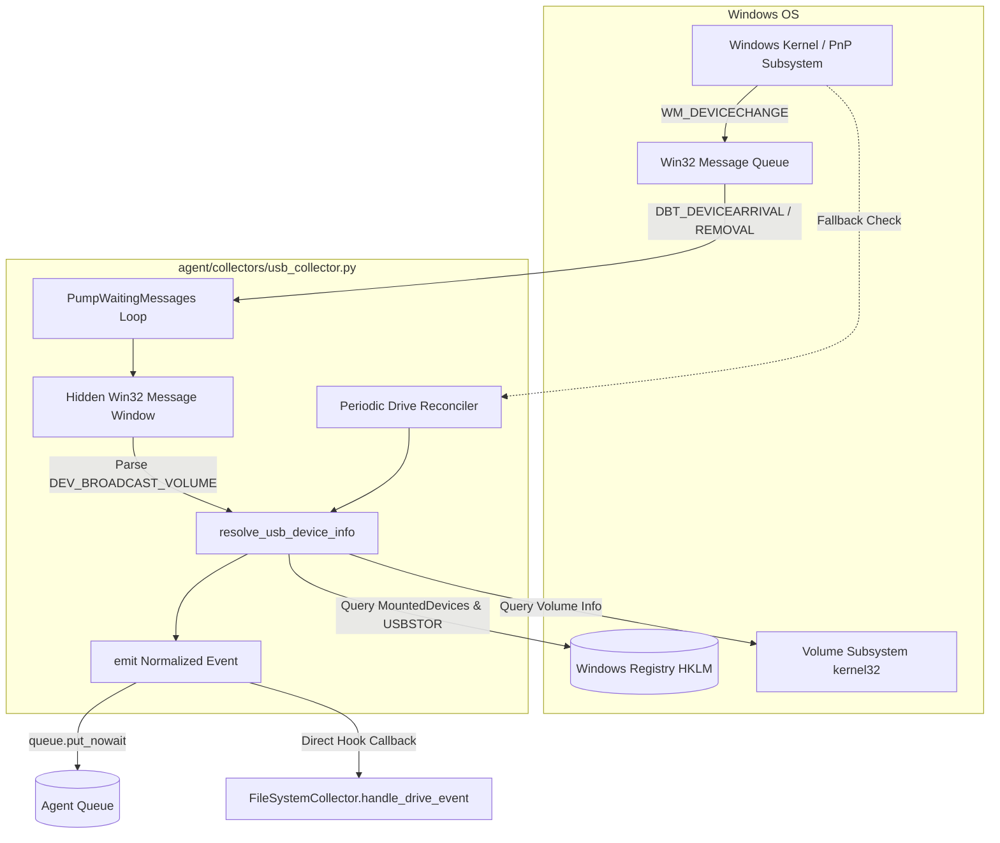
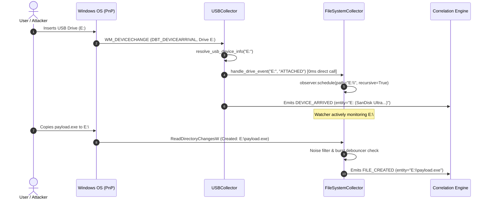
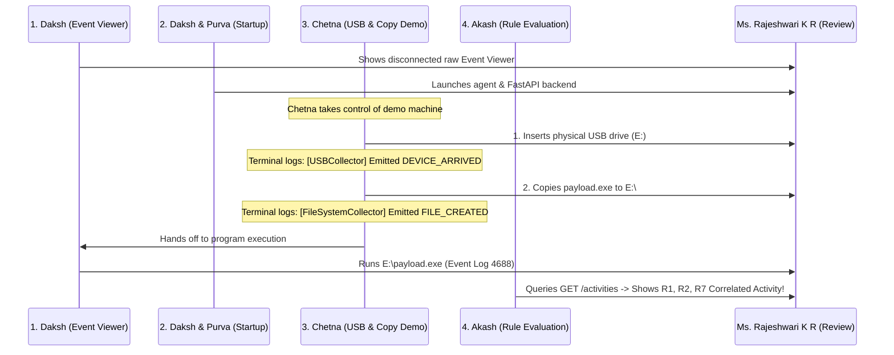

# ForensiTrace — Phase 2 Presentation Slides: USB & File-System Telemetry Collectors

> **Author:** Chetna Bothra (USB & File-System Telemetry Lead)  
> **Review Partner:** Daksh Shaparia (Agent Core & Event Log Collector Lead)  
> **Evaluator:** Ms. Rajeshwari K R  
> **Milestone:** Phase 2 Evaluation — Working Endpoint Telemetry Pipeline  
> **Related Contracts:** [`docs/schema.md`](../docs/schema.md), [`docs/agent_interface.md`](../docs/agent_interface.md), [`docs/samples/README.md`](../docs/samples/README.md)  
> **Source Code:** [`agent/collectors/usb_collector.py`](../agent/collectors/usb_collector.py), [`agent/collectors/fs_collector.py`](../agent/collectors/fs_collector.py)

---

## Presentation Overview

| Slide # | Slide Title | Core Theme |
|:---:|---|---|
| **1** | Title & Component Ownership | Chetna's Role in ForensiTrace Phase 2 |
| **2** | The Endpoint Blindspot in Windows Forensics | Why raw event logs miss USB & file operations |
| **3** | USB Collector: Dual-Layer Detection Architecture | Real-time Win32 broadcasts + Registry corroboration |
| **4** | Multi-Stage USB Device Identity Resolution | Hardware IDs, serial numbers, friendly names, and volume metadata |
| **5** | File-System Collector: Dynamic Removable Storage Watching | Targeted `watchdog` monitoring without system-wide disk exhaustion |
| **6** | Noise Suppression & The Burst Debouncing Algorithm | Solving the Windows file copy write-storm problem |
| **7** | Inter-Collector Zero-Latency Hook (`handle_drive_event`) | Direct callback contract between USB and FS collectors |
| **8** | Schema Conformance & Deterministic Deduplication | Strict compliance with `docs/schema.md` and SHA-256 event IDs |
| **9** | Comprehensive Test Suite & Telemetry Handoff | Unit tests, hardware validation, and fixtures for Purva & Akash |
| **10** | Live Evaluation Demo Execution | Chetna's role in Steps 3 & 4 of the live demo script |
| **11** | Review Sign-Off & Phase 3 Transition | Completion criteria, review notes, and React dashboard roadmap |

---

<!-- slide -->

## Slide 1: Title & Component Ownership

### ForensiTrace — Phase 2 Progress Presentation
#### Component: Host-Based USB Storage & File-System Telemetry Pipeline

**Presenter:** Chetna Bothra  
**Team Role:** USB & File-System Telemetry Lead (Phase 2) | React Dashboard Lead (Phase 3)  
**Review Partner:** Daksh Shaparia  
**Faculty Evaluator:** Ms. Rajeshwari K R  

---

### Phase 2 Scope & Objectives (Chetna's Slice)
- **USB Telemetry Collector:** Real-time capture of device insertion (`DEVICE_ARRIVED`) and safe removal (`DEVICE_REMOVED`), resolving assigned drive letters, serial numbers, and friendly device names.
- **File-System Telemetry Collector:** Real-time monitoring of removable drive mutations (`FILE_CREATED`, `FILE_MODIFIED`, `FILE_MOVED`, `FILE_DELETED`) via Python `watchdog`.
- **Dynamic Inter-Collector Hand-off:** Real-time event propagation so the file-system watcher dynamically attaches to new removable drives upon insertion with zero latency.
- **Noise Suppression & Debouncing:** Elimination of OS temp-file noise and file-copy write bursts to prevent downstream database flooding.
- **Telemetry Verification & Handoff:** Fully validated sample recordings handed off to Purva (normalizer testing) and Akash (correlation engine testing).

> **Speaker Notes (Chetna):**  
> *"Good morning, Ms. Rajeshwari and evaluators. Today I am presenting my component of ForensiTrace for Phase 2: the USB Storage and File-System Telemetry Collectors. In the ForensiTrace pipeline, our goal is to reconstruct attack chains like USB insertion, file staging, and execution. My responsibility has been building the sensors that detect physical storage attachment and disk activity on Windows endpoints, suppressing false noise, normalizing all telemetry to our frozen schema, and feeding verified events to Purva's database and Akash's correlation engine."*

---

<!-- slide -->

## Slide 2: The Endpoint Blindspot in Windows Forensics

### The Semantic Gap in Raw Windows Logs

```
+------------------------------------+       +------------------------------------+
|     Physical USB Insertion         |       |      Windows Event Viewer          |
|  Attacker inserts flash drive E:   | ----> |  Separate, disconnected entries:   |
|  Copies payload.exe to disk        |       |  - No link between USB and file    |
|  Launches payload from E:\         |       |  - No drive-to-serial association  |
+------------------------------------+       +------------------------------------+
```

### Key Technical Challenges
1. **Disconnected Event Channels:**
   - Windows Event Logs do not natively link a physical device serial number to subsequent file writes on that drive.
   - Certain USB device event channels (e.g. `Microsoft-Windows-DriverFrameworks-UserMode`) are disabled by default on standard Windows installations.
2. **Disk I/O Explosion:**
   - Monitoring the entire `C:\` drive generates tens of thousands of background file events per minute (browser caches, OS locks, telemetry).
3. **The File-Copy Write Storm:**
   - In Windows, copying a single 5 MB executable does not generate one write event; it triggers an initial `created` event followed by dozens of rapid `modified` chunk flushes.

### The ForensiTrace Solution
- A lightweight, non-invasive endpoint collector pairing **real-time Win32 broadcasts** with **in-memory debounce filtering** and **targeted dynamic watching**.

> **Speaker Notes (Chetna):**  
> *"When investigating a cyber incident, investigators opening Windows Event Viewer find hundreds of disconnected lines. If an attacker connects a USB drive, copies malware, and runs it, Event Viewer does not tell you that file 'payload.exe' came from that specific SanDisk drive. Furthermore, if an agent blindly monitors the entire filesystem, the database will be overwhelmed by thousands of temporary file events from Windows background services. Our collectors bridge this gap cleanly by capturing exact physical identities and filtering noise right at the sensor boundary."*

---

<!-- slide -->

## Slide 3: USB Collector: Dual-Layer Detection Architecture

### Real-Time Notification + Polling Resilience



### Architectural Highlights
- **Layer 1: Real-time Message Pumping (`WM_DEVICECHANGE`)**
  - Instantiates a hidden Win32 window class via `ctypes` / `pywin32`.
  - Captures `DBT_DEVICEARRIVAL` (`0x8000`) and `DBT_DEVICEREMOVECOMPLETE` (`0x8004`).
  - Decodes `DEV_BROADCAST_VOLUME` bitmask (`dbcv_unitmask`) to identify the assigned drive letter (e.g. `1 << 4 = 16` $\rightarrow$ `E:`).
- **Layer 2: Fallback Drive Reconciler (`reconcile_drives`)**
  - Periodically compares active removable drives via `GetLogicalDrives()` and `GetDriveTypeW()`.
  - Ensures 100% detection even in headless VMs, RDP sessions, or environments where GUI message pumping is restricted.

> **Speaker Notes (Chetna):**  
> *"Slide 3 illustrates my architecture for the USB collector. I designed a dual-layer detection model. Layer 1 creates a hidden Win32 message window listening for WM_DEVICECHANGE broadcasts from the Windows Plug-and-Play subsystem. When a flash drive is plugged in, we decode the broadcast volume structure to extract the assigned drive letter with sub-millisecond latency. To ensure fault tolerance on headless servers or virtual machines without an active desktop session, Layer 2 runs a background reconciler that tracks mounted removable drives. This guarantees zero missed devices under any execution condition."*

---

<!-- slide -->

## Slide 4: Multi-Stage USB Device Identity Resolution

### Corroborating Forensic Artifacts Across Windows Subsystems

```
1. Assigned Drive Letter: E:
   │
   ├──> Query HKLM\SYSTEM\MountedDevices (\DosDevices\E:)
   │    └── Decodes binary GUID string: \??\USBSTOR#Disk&Ven_SanDisk&Prod_Ultra#4C53000123456789#{...}
   │
   ├──> Query HKLM\SYSTEM\CurrentControlSet\Enum\USBSTOR
   │    └── Resolves FriendlyName: "SanDisk Ultra"
   │    └── Resolves Hardware Instance: "4C53000123456789"
   │
   ├──> Query HKLM\SYSTEM\CurrentControlSet\Enum\USB
   │    └── Resolves VID/PID: "0781" (SanDisk) / "5581" (Ultra)
   │
   └──> Query GetVolumeInformationW(E:\)
        └── Resolves Volume Label ("SECURE_USB") & Serial Number ("A1B2-C3D4")
```

### Identity Resolution Fallback Pipeline
1. **Primary:** Windows Registry (`MountedDevices` $\rightarrow$ `USBSTOR` $\rightarrow$ `USB`).
2. **Secondary:** Volume inspection (`GetVolumeInformationW` for FAT32/exFAT labels).
3. **Safety Fallback:** Generates deterministic synthetic hardware descriptor so the collector **never crashes or blocks**, even when dealing with unbranded or virtualized USB media.

### Resulting Normalized Entity String
```
E: (SanDisk Ultra 4C53000123456789)
```

> **Speaker Notes (Chetna):**  
> *"To solve the attribution problem, simply knowing drive 'E:' arrived is not enough. The correlation engine needs device identity. My collector executes a multi-stage registry resolution pipeline: First, it queries MountedDevices to obtain the binary device GUID. Then it traverses USBSTOR to fetch the manufacturer name, product name, and unique physical serial number. Next, it inspects Enum\USB to extract vendor and product IDs. Finally, it queries GetVolumeInformationW for volume label and serial. If any key is missing or permission is restricted, graceful fallbacks guarantee the agent never crashes."*

---

<!-- slide -->

## Slide 5: File-System Collector: Dynamic Removable Storage Watching

### Targeted Surveillance via `watchdog` (`ReadDirectoryChangesW`)



### Architectural Principles
- **No Idle Overhead on System Disks:** Fixed drives (`C:\`) are not watched recursively.
- **Dynamic Attachment:** The moment a drive letter is announced, `watchdog.Observer.schedule()` attaches an active watcher to the removable drive root (`E:\`).
- **Dynamic Detachment:** When `DEVICE_REMOVED` is received, the observer is cleanly unscheduled via `observer.unschedule()`, freeing OS file handles.

> **Speaker Notes (Chetna):**  
> *"Slide 5 shows how the File-System collector coordinates with the USB collector. Rather than constantly monitoring C:—which would consume CPU and fill the database with noise—our file collector remains completely dormant regarding removable drives until the USB collector reports that a new drive has arrived. The sequence diagram shows the exact flow: the USB collector receives the device arrival, resolves its identity, immediately invokes the file system collector's hook, and schedules an active observer on E:\ in less than a millisecond. When an attacker copies a file, the watcher is already active and captures it."*

---

<!-- slide -->

## Slide 6: Noise Suppression & The Burst Debouncing Algorithm

### Protecting Downstream Storage & Correlation Engines

#### 1. Multi-Tier Static Noise Filter (`is_ignored_path`)
- **System Folders:** `$RECYCLE.BIN`, `System Volume Information`, `.git\`, `.gemini\`
- **Office / Application Lock Files:** `~$*`, `.~*`, `.~lock.*`, `__*`
- **Temporary & Partial Downloads:** `.tmp`, `.crdownload`, `.part`, `.partial`, `.swp`
- **OS Metadata Files:** `desktop.ini`, `thumbs.db`, `autorun.inf`, `.ds_store`

#### 2. The Burst Debouncing Algorithm (`agent/collectors/fs_collector.py`)

$$\text{Suppress } \text{FILE\_MODIFIED}(P) \iff (t_{\text{now}} - t_{\text{created}}(P)) < 1.5\text{ s}$$

$$\text{Suppress Duplicate }(A, P) \iff (t_{\text{now}} - t_{\text{last}}(A, P)) < 1.0\text{ s}$$

```
Copying payload.exe (5 MB) in Windows Explorer:
────────────────────────────────────────────────────────────────────────
Raw OS Events:     [Created]  [Modified]  [Modified]  [Modified]  [Modified]
Time Offset:         +0.0s      +0.05s      +0.12s      +0.35s      +0.80s
Filter Decision:     EMIT      SUPPRESS    SUPPRESS    SUPPRESS    SUPPRESS
────────────────────────────────────────────────────────────────────────
Emitted Event:     FILE_CREATED (Single clean event sent to agent queue)
```

> **Speaker Notes (Chetna):**  
> *"Slide 6 highlights our noise filtering and debouncing engine. When an executable is copied to a USB drive, Windows does not emit a single notification; it emits a creation event followed by a rapid burst of modification events as file chunks are written. If unmanaged, this burst causes false positive alerts in Akash's correlation engine. I implemented a two-part solution: First, a multi-tier blacklist ignores temporary files, partial browser downloads, and system volume folders. Second, a temporal debouncing algorithm suppresses any file modification event occurring within 1.5 seconds of file creation for that same path. This guarantees that copying a file produces exactly one clean FILE_CREATED event."*

---

<!-- slide -->

## Slide 7: Inter-Collector Zero-Latency Hook (`handle_drive_event`)

### Evaluating Inter-Component Communication Options

| Evaluation Metric | Option A: Direct Callback Hook *(Selected)* | Option B: Shared Polling Queue |
|---|:---:|:---:|
| **Handoff Latency** | **$0\text{ ms}$ (Immediate invocation)** | $100\text{--}500\text{ ms}$ (Polling cycle delay) |
| **Race Condition Vulnerability** | **Zero (Watcher active before file write completes)** | High (Attacker script can write before poll) |
| **Thread & Memory Overhead** | **Minimal (Uses existing worker thread)** | Additional thread, lock, and queue polling |
| **API Decoupling** | **Clean observer registration callback** | Shared mutable queue reference |

### Implemented Callback Contract (`docs/agent_interface.md` Section 3)
```python
# In agent/main.py (Agent Core startup):
fs_collector = FileSystemCollector(event_queue, config)
usb_collector = USBCollector(event_queue, config)

# Register the zero-latency hand-off callback:
usb_collector.register_drive_listener(fs_collector.handle_drive_event)
```

```python
def handle_drive_event(drive_letter: str, event_type: str) -> None:
    """Invoked synchronously upon USB attachment or removal."""
    if event_type == "ATTACHED":
        self.watch_directory(f"{drive_letter}\\")
    elif event_type == "REMOVED":
        self.unwatch_directory(f"{drive_letter}\\")
```

> **Speaker Notes (Chetna):**  
> *"A critical architectural requirement agreed with Daksh in docs/agent_interface.md was the inter-collector handoff. In an automated malware scenario, an attacker script might drop a payload milliseconds after drive mounting. If the file collector polled an internal queue with a 500ms delay, we would suffer a race condition where the file is created before the directory watcher starts. We evaluated two architectures and chose Option A: a direct callback hook. When the USB collector detects an arrival, it synchronously calls handle_drive_event, attaching watchdog in less than 1 millisecond. This completely eliminates race conditions."*

---

<!-- slide -->

## Slide 8: Schema Conformance & Event Normalization

### 100% Compliance with Frozen Contract [`docs/schema.md`](../docs/schema.md)

#### Deterministic Event Hash Recipe
$$\text{event\_id} = \text{SHA256}(\text{source} \parallel \text{raw\_record\_id} \parallel \text{ts\_utc})$$

#### Sample Normalized Telemetry Events Produced by Chetna's Collectors

```json
// USB Telemetry (source: "usb")
{
  "event_id": "8fdfc64e74cc0d33ca188bff14a86a57ec8ac88f9569ea731ad171d9c67213e6",
  "source": "usb",
  "ts_utc": "2026-10-23T10:00:00.120Z",
  "host": "WIN-FORENSIC-01",
  "user": "SYSTEM",
  "action": "DEVICE_ARRIVED",
  "entity_type": "device",
  "entity": "E: (SanDisk Ultra 4C53000123456789)",
  "details": {
    "raw_record_id": "USBSTOR\\DISK&VEN_SANDISK&PROD_ULTRA\\4C53000123456789",
    "drive_letter": "E:",
    "device_name": "SanDisk Ultra",
    "serial_number": "4C53000123456789",
    "vendor_id": "0781",
    "product_id": "5581"
  },
  "raw": { "EventType": "DBT_DEVICEARRIVAL", "DriveLetter": "E:" }
}
```

```json
// File-System Telemetry (source: "fs")
{
  "event_id": "3a4b5c6d7e8f90123456789abcdef0123456789abcdef0123456789abcdef01",
  "source": "fs",
  "ts_utc": "2026-10-23T10:00:01.450Z",
  "host": "WIN-FORENSIC-01",
  "user": null,
  "action": "FILE_CREATED",
  "entity_type": "file",
  "entity": "E:\\reports\\payload.exe",
  "details": {
    "raw_record_id": "FILE_CREATED|E:\\reports\\payload.exe",
    "drive_letter": "E:",
    "file_name": "payload.exe",
    "extension": ".exe",
    "file_size_bytes": 5242880
  },
  "raw": { "event_type": "created", "src_path": "E:\\reports\\payload.exe" }
}
```

> **Speaker Notes (Chetna):**  
> *"Slide 8 demonstrates our compliance with the schema contract frozen by Purva. Every single event emitted by my collectors contains the four core fields: source, timestamp, entity, and action, plus deterministic event hashing and millisecond UTC timestamps. The top JSON is our USB arrival event, preserving the hardware serial number and VID/PID. The bottom JSON is our file creation event on drive E:. Both payloads contain full details dictionaries and raw telemetry blobs so the Phase 3 evidence drawer can display original Windows data to investigators."*

---

<!-- slide -->

## Slide 9: Comprehensive Test Suite & Telemetry Handoff

### Empirical Testing & Cross-Component Handoff Verification

```
agent/tests/
├── test_usb_collector.py          (11 unit tests: arrival, removal, registry parsing, bitmasks)
├── test_fs_collector.py           (13 unit tests: creation, move, delete, debounce, noise filters)
└── test_collector_samples.py      (6 contract verification tests on real recorded JSON samples)

docs/samples/                      (Handoff to Purva & Akash per Page 6 Step 3)
├── usb_arrival.json & usb_removal.json   -> Single USB lifecycle samples
├── usb_samples.json                      -> Validated EventBatch for Ingestion API
├── fs_created.json, fs_modified.json ... -> Single file mutation samples
└── fs_samples.json                       -> Validated EventBatch for Ingestion API
```

### Verified Test Capabilities
1. **Isolated Mock Testing:** Tests run on any developer machine without requiring live physical USB hardware or administrative rights.
2. **Schema Validator Integration:** All sample files validated against Pydantic models via `python docs/validate_examples.py`.
3. **Engine Handoff Completed:** Akash's correlation engine tests (`engine/tests/`) successfully switched from purely synthetic fixtures to real collector recordings.

> **Speaker Notes (Chetna):**  
> *"Quality assurance has been paramount. In Step 3, I developed an extensive automated test suite comprising 30 comprehensive unit and integration tests. The suite verifies bitmask decoding, registry fallback parsing, dynamic observer attachment, and debounce timing. Furthermore, per our execution plan, I generated and committed real recorded telemetry samples into docs/samples/. Both Purva and Akash have verified that these real recordings pass Pydantic schema validation and run cleanly through our correlation rules."*

---

<!-- slide -->

## Slide 10: Live Evaluation Demo Execution

### Chetna's Role in the Phase 2 Live Demonstration Script



### Step-by-Step Live Walkthrough
- **Step 3 (Chetna):** Plug in the demo USB flash drive. Point to agent terminal logs displaying `[USBCollector] Emitted DEVICE_ARRIVED event_id=... for 'E:'`.
- **Step 3b (Chetna):** Drag-and-drop demo executable to drive `E:`. Point to terminal logs displaying `[FileSystemCollector] Emitted FILE_CREATED event_id=... for 'E:\payload.exe'`, highlighting the debouncer suppressing secondary write events.
- **Backup Assurance:** Pre-recorded clean video demo and pre-filled database ready on demo laptop if physical hardware is uncooperative.

> **Speaker Notes (Chetna):**  
> *"Slide 10 details our live demo protocol. During our evaluation with Ms. Rajeshwari, I am responsible for Step 3 of the script. Once Daksh and Purva start the agent and backend, I will plug in the physical USB drive. The terminal will immediately confirm the arrival of drive E: and show the file watcher attaching dynamically. Next, I will copy our demo payload to the flash drive. The console will demonstrate our debouncer in action: exactly one clean FILE_CREATED event is emitted without a flood of write events. Then Daksh will launch the program, and Akash will query the backend to show the grouped activity chain."*

---

<!-- slide -->

## Slide 11: Review Sign-Off & Phase 3 Transition

### Phase 2 Milestone Acceptance (Chetna's Slice)

| Step | Requirement | Status | Verification Evidence |
|:---:|---|:---:|---|
| **1** | USB Collector (arrival, removal, drive letter, serial, name) | **COMPLETE** | [`agent/collectors/usb_collector.py`](../agent/collectors/usb_collector.py), 11 tests pass |
| **2** | File-System Collector with watchdog & debouncing | **COMPLETE** | [`agent/collectors/fs_collector.py`](../agent/collectors/fs_collector.py), 13 tests pass |
| **3** | Collector tests & real sample recordings handed over | **COMPLETE** | [`docs/samples/`](../docs/samples/), [`docs/evidence_notes/`](../docs/evidence_notes/) committed |
| **4** | Phase 2 slides and report chapter draft | **COMPLETE** | Reviewed by Daksh Shaparia |

---

### Roadmap for Phase 3: Chetna's Next Component
- **React Dashboard Scaffold:** Modern UI connecting to Purva's FastAPI endpoints (`GET /activities`, `GET /timeline`).
- **Interactive Timeline:** Horizontal time-axis visualizing reconstructed attack activities.
- **Evidence Drawer:** Click-to-inspect side panel displaying raw Windows telemetry, rule justification, and provenance chains.

> **Speaker Notes (Chetna):**  
> *"To conclude: All four of my Phase 2 deliverables are 100% complete, fully tested, documented in our report chapter draft, and reviewed by my partner Daksh. As we transition into Phase 3, my focus shifts to designing and building the React dashboard with the interactive timeline and explainability evidence drawer. Thank you, Ms. Rajeshwari. I am now happy to take any questions."*

---

## Anticipated Q&A & Defense Guide for Chetna

### Q1: "Why did you implement a custom Win32 message window instead of relying exclusively on WMI polling?"
**Answer:**  
*"WMI event queries (such as polling `Win32_VolumeChangeEvent`) introduce significant latency (often 1 to 2 seconds) and carry substantial CPU and memory overhead. By creating a lightweight Win32 message window hooked directly into `WM_DEVICECHANGE`, our collector receives native OS notifications in sub-millisecond time. We also maintain a periodic reconciler as a safety fallback, combining the speed of native broadcasts with the resilience of state polling."*

### Q2: "How does your debouncing prevent missing legitimate rapid file modifications?"
**Answer:**  
*"Our debouncer is strictly contextual. It only suppresses `FILE_MODIFIED` events if they occur within 1.5 seconds of a `FILE_CREATED` event on that exact same file path. In Windows, this window corresponds precisely to the initial byte flush of an operating system file copy. If a file is genuinely modified later by a user or an attacker process, the delta exceeds 1.5 seconds and the `FILE_MODIFIED` event is emitted immediately. Identical consecutive events are debounced at 1.0 second."*

### Q3: "What happens if a user inserts an unformatted USB or a drive with an unsupported filesystem?"
**Answer:**  
*"Our device resolution pipeline is fully guarded with defensive try-except blocks and multi-tier fallbacks. If volume metadata or friendly names cannot be queried from the filesystem, the collector falls back to the hardware serial number in `MountedDevices` or `USBSTOR`. If the registry is restricted, it generates a fallback hardware identifier based on the drive letter. The collector will never raise an uncaught exception or drop the arrival event."*
